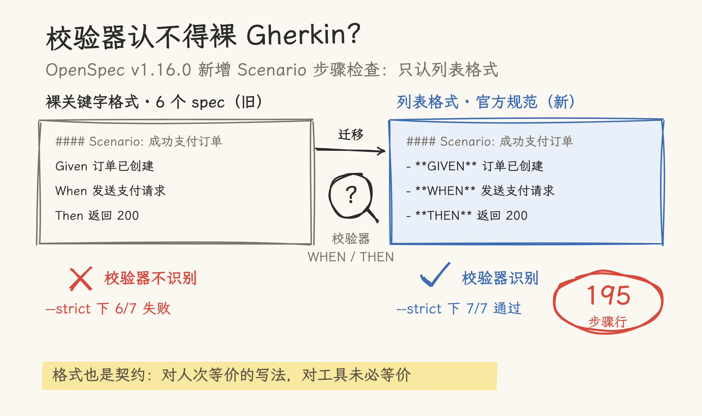

# When the Validator Can't Read Your Gherkin: OpenSpec v1.16.0 Workflow Practice

OpenSpec shipped v1.15.0 (2026-10-24) and v1.16.0 (2026-10-30) in quick succession. The first is about install and upgrade experience; the second brings the repository's **first breaking change** (a Node version floor for npm installs) and a new spec validation. That new validation exacted a price the moment we upgraded: **6 of 7 main specs failed under `--strict`** — their Gherkin style, unchanged since the v1-MVP, was not recognized by the new checker.

This article records the full upgrade: a first real run of `update --dry-run`, the historical format debt exposed by the step check, an accidental live test of the config.yaml guard, and a migration of 195 scenario steps carried out under `skip_specs`.



_The same Gherkin, two writings: the v1.16.0 step check only recognizes the list format on the right; this practice migrated 195 step lines across 48 scenarios._

## 1. What Changed in the Two Releases

### 1.1 v1.15.0: Standalone Install and Dry-Run

- **One-command install without Node** — `curl -fsSL https://raw.githubusercontent.com/Fission-AI/OpenSpec/main/scripts/binary/install.sh | sh`; every release now ships binaries for macOS, Linux (glibc/musl), and Windows on x64/arm64 with `SHA256SUMS`. npm and other existing channels keep working.
- **`openspec update --dry-run`** — reports which files an update would add, change, or delete without writing anything; `--json` makes it machine-readable. For a workflow that refreshes `.claude/` on every upgrade, this turns "blind force update" into "preview the diff first."
- **Speed and fixes** — `--json` variants of `status`, `instructions`, `validate` and others no longer load the spinner; `new change`'s progress line names the schema actually used; `/opsx:verify` matches a REMOVED requirement to its baseline by exact name, so a similarly named replacement is no longer mistaken for it.

### 1.2 v1.16.0: Node Floor and New Validation

- **BREAKING: npm installs require Node ≥ 22.12.0** — Node 20 reached end-of-life on April 30, 2026. The standalone binary doesn't use Node, and Homebrew installs manage their own Node; both are unaffected. If you cannot upgrade Node, switch to the standalone install.
- **Scenario step check** — `openspec validate` checks every scenario in main specs and change deltas: a missing WHEN/GIVEN step or a missing THEN step produces a warning, and fails under `--strict`. The error message's example format is `- **WHEN** ...` / `- **THEN** ...`.
- **Invalid config.yaml no longer passes silently** — previously `validate` passed while every rule in an unreadable or invalid `openspec/config.yaml` was ignored; it now exits 1.
- **Other** — install from `openspec.dev`; when no OpenSpec root is found and stores are registered, the error suggests the matching `--store` flag (suggesting only, never picking); inline triple-backtick code no longer opens a phantom fence that hid following requirements; `###Requirement:` headers without a space are now reported the way archive reads them.

## 2. Upgrade Steps and Compatibility Checks

```bash
npm install -g @fission-ai/openspec@1.16.0
openspec --version        # 1.16.0
openspec version --check  # OpenSpec is up to date.
```

### 2.1 First Run of dry-run

Five upgrades in this repository went straight to `update --force`; this time we looked before touching:

```text
$ openspec update --dry-run
6 file(s) would change:
  update  .claude/skills/openspec-apply-change/SKILL.md  (claude)
  update  .claude/skills/openspec-archive-change/SKILL.md  (claude)
  ... (6 skill files total)

$ openspec update --dry-run --json
{ "changes": 6, "notes": 0, "failures": 0 }
```

The actual diff after `--force` matched the preview exactly: six skill files changed by one line each (`generatedBy: "1.14.3"` → `"1.16.0"`), and the six command files were unchanged. For a release where templates didn't move, dry-run reduces confirmation cost to nearly zero.

### 2.2 The Breaking Change in Practice

This machine runs Node v26.13.0 ≥ 22.12.0, so the npm install is unaffected. Two floors need to be distinguished:

- **The CLI's Node ≥ 22.12.0** — constrains only `npm install -g @fission-ai/openspec`;
- **The examples' Node v20+** — `examples/ecommerce-mini/` is a zero-dependency native implementation and runs unchanged on v20+; unrelated to the CLI.

For readers: if CI installs the CLI via npm, check the Node version there — or switch to the standalone binary, which sidesteps the Node floor entirely.

### 2.3 The Step Check: 6/7 Strict Failures

The first `validate --specs --strict` after the upgrade came as a surprise:

```text
✗ spec/cart-management
  ⚠ Requirement "购物车商品添加": scenario "添加商品到购物车" is missing a
    WHEN/GIVEN step and a THEN step...
✗ spec/catalog-management
  ... (6 specs failing in total)
✓ spec/product-query
Totals: 1 passed, 6 failed (7 items)
```

The only difference between passing and failing was **format**. `product-query` writes scenario steps as list items:

```markdown
#### Scenario: 查询存在的商品
- **WHEN** 客户端发送 `GET /api/products/{id}`，且该 ID 对应的商品存在
- **THEN** 系统返回 200 状态码及该商品的完整 JSON 对象
```

The other six specs have used bare keyword lines since the v1-MVP:

```markdown
#### Scenario: 成功支付订单
Given 订单存在且状态为 PENDING_PAYMENT
When 发送 POST /api/payments/:orderId
Then 返回状态码 200
```

Both readings are equivalent to a human, but the checker recognizes only the list format — matching its own error example (`- **WHEN** ...`) and OpenSpec's official template (the Main Spec Format Reference in the skill docs). This echoes v1.13.0 exactly: **the findings report caught Purpose placeholders; the step check caught scenario formatting; every new layer of tooling guard surfaces another layer of accumulated debt**. Back then product-query was the problem (its Purpose was an archive placeholder); this time it was the only passing exemplar.

### 2.4 An Accidental Live Test of the config.yaml Guard

While updating the specs rule in `config.yaml`, the first draft contained a `: ` sequence (`keywords: "- **GIVEN**"...`), which broke YAML parsing. Immediately:

```text
$ openspec validate --archived
Error: Could not parse .../openspec/config.yaml (Unexpected scalar at node end
at line 26, column 128...)
```

A live demonstration of the new v1.16 guard: **the old version would have passed silently while ignoring every rule; the new version exits with an error at once**. The fix was to drop the colon and the nested quotes, after which the rule injected normally.

## 3. The Practice Change: scenario-step-format-migration

### 3.1 Why Migrate the Main Specs Directly Instead of Writing Deltas

Intuition says "changing specs should go through change deltas," but this case does not fit:

- About 20 requirements and 48 scenarios are involved; a MODIFIED delta must restate each requirement and every scenario in full, so the diff would be wall-to-wall formatting noise — violating "review only what actually changed";
- The v1.11.0 practice already hit the scenario-level constraints of MODIFIED (no dropped scenarios, no renamed scenarios); running a mechanical format change through the delta channel turns it into high-risk hand editing;
- The migration changes zero behavior, and `skip_specs: true` states exactly that, while proposal/design/tasks still document the decision.

### 3.2 Scripted Migration with Fidelity Checks

The right tool for a format migration is a script, not hands. The migration script carries two built-in assertions:

- the `#### Scenario:` count per file is identical before and after;
- the step-line count is identical (`Given`/`When`/`Then`/`And`/`But` → `- **GIVEN**`/`- **WHEN**`/`- **THEN**`/`- **AND**`/`- **BUT**`).

```text
openspec/specs/cart-management/spec.md:   11 scenarios, 41 steps migrated
openspec/specs/catalog-management/spec.md: 11 scenarios, 43 steps migrated
openspec/specs/domain-model/spec.md:       5 scenarios, 23 steps migrated
openspec/specs/error-handling/spec.md:     6 scenarios, 24 steps migrated
openspec/specs/order-management/spec.md:  11 scenarios, 49 steps migrated
openspec/specs/payment/spec.md:            4 scenarios, 15 steps migrated
total: 195 step lines migrated, all scenario counts preserved
```

After migration, `git diff` was machine-checked: no scenario heading lines changed, and apart from old step lines versus new list lines there were no other additions or deletions — **scenario names and step text preserved verbatim**. The script's first version also exposed a classic mistake: running `findall` over the whole text with a regex missing `re.M`, so `^` matched only the start of the file; the assertion aborted the run instead of silently producing a wrong result — checks-first paying off again.

### 3.3 The config.yaml Rule, Updated

Part of the debt's root cause was rule ambiguity: `config.yaml` only said "Use Given/When/Then (Gherkin) format," and both bare keywords and list items are Gherkin. The rule now names the list format explicitly, so deltas generated by future proposes conform to the check by construction instead of accruing new debt.

### 3.4 Results

| Check | Before | After |
| --- | --- | --- |
| `validate --specs` (plain) | 7 passed + many step warnings | 7 passed, no warnings |
| `validate --specs --strict` | 1/7 | **7/7** |
| `validate --specs --report findings` | — | no findings |
| `validate --archived` | 6/6 | 6/6 (archived deltas unaffected by this check) |
| Node `npm test` | 18/18 | 18/18 |
| Python `pytest` | 7/7 | 7/7 |

Note that the archived changes' deltas are still in the bare format, but `validate --archived` is unaffected; per repository convention the archive is teaching material and stays as-is.

## 4. Takeaways and Open Observations

### 4.1 "Equivalent Writings" the Validator Can't Read Are the Norm

Bare-keyword Gherkin and the list format are equivalent to people, not to tools. An SDD single source of truth serves humans and AI/tools at once; format is part of the contract. Once the official template defines a canonical format, departing from it is debt — the only uncertainty is when the bill arrives. This time it arrived the day of the upgrade.

### 4.2 dry-run Changes the Upgrade Ritual

`update --dry-run --json` turns "how much did the templates change?" from a post-hoc diff into a preview. Small spans (six files × one line this time) cost almost nothing to confirm; large spans (last upgrade's +353/−97) can go straight into the CHANGELOG from the preview.

### 4.3 Breaking Floors Need Their Audience Named

Node ≥ 22.12 constrains only the CLI's npm install path. A project's own runtime floor (the examples' Node v20+) and the toolchain's floor are different things; mixing them in documentation misleads readers about upgrade cost. The standalone binary is the official way around the Node floor.

### 4.4 Open Observations

- **Payment remains the largest spec-code gap**: four scenarios, zero implementation — the first choice for the next practice.
- **Error response formats are still not unified**: Node's `{code, message}` versus Python's `{detail}`.
- **Node prod route coverage** and **the dev server's fixed `user_dev`**: unchanged from the v1.14.3 article's observations.
- **Bare-format deltas in the archive**: every archived change's deltas use the bare format. If a future release makes `validate --archived` run the step check too, that will force a one-time decision (migrate or exempt).

---

_This article is based on the `scenario-step-format-migration` practice in the [OpenSpec Practise](https://github.com/ForceInjection/OpenSpec-practise) repository (2026-11-02); full artifacts live under `openspec/changes/archive/2026-11-02-scenario-step-format-migration/`._
